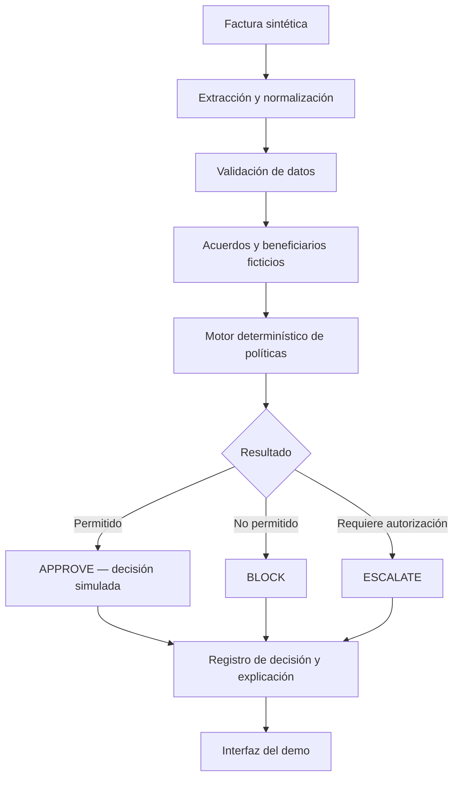

# Reto 30X Blinka — AI Accounts Payable Decision Agent

> **Agentes que pagan por la empresa**  
> **Documento:** `BLINKA-README-001` · **Versión:** `0.1.0` · **Estado:** `DRAFT` · **Fecha:** `2026-10-17`  
> **Repositorio:** [RobertMX23/Reto-30XBlinka](https://github.com/RobertMX23/Reto-30XBlinka)

## 1. Project Overview

| Campo | Descripción |
|---|---|
| Programa | Hackatón 30X AI DEVs |
| Reto | Blinka — Agentes que pagan por la empresa |
| Área / tipo | Producto / crear algo nuevo |
| Entregable oficial | Agente funcionando sobre facturas simuladas, con pantalla simple |
| Dominio | Accounts Payable (cuentas por pagar) |
| Propósito | Evaluar cuentas y decidir si aprobar, bloquear o escalar con reglas empresariales |
| Alcance de ejecución | **Sin pagos reales ni integración obligatoria a plataformas de pago** |
| Estado del proyecto | Ingeniería de requerimientos y diseño preliminar |
| Stack tecnológico | Por decidir |

**Principio rector:** *La IA puede interpretar documentos; las reglas de negocio controlan la autorización; las excepciones requieren intervención humana.*

En este repositorio, **`APPROVE` o `APROBADA` significa decisión positiva simulada**, nunca dinero transferido o liquidado.

## 2. Problem Statement — Proceso actual (AS-IS)

Blinka plantea un proceso repetitivo y manual en el que los equipos financieros reciben solicitudes de cobro, las contrastan con acuerdos, solicitan aprobaciones, capturan pagos y llevan el seguimiento en hojas de cálculo.

| Paso | Actividad actual | Entrada típica | Fricción identificada |
|---|---|---|---|
| 01 | Recepción | Correo, PDF o chat | Canales y formatos heterogéneos |
| 02 | Revisión | Factura, acuerdo comercial, datos del beneficiario | Búsqueda y validación manual |
| 03 | Aprobación | Solicitud a una persona por correo o chat | Dependencia de disponibilidad humana |
| 04 | Creación de pago | Plataforma de pagos, posiblemente otra moneda/país | Captura repetida; **fuera de alcance del MVP** |
| 05 | Conciliación | Hoja de cálculo y movimientos | Trabajo posterior; **no habrá conciliación bancaria real** |

**Hallazgo preliminar de la sección 02:** deben diferenciarse tres conceptos: **validación documental ≠ aprobación de una solicitud ≠ ejecución de una transacción financiera**.

## 3. Objective & Success Criteria

### Objetivo general

Construir un agente demostrable que analice facturas de una empresa ficticia, aplique reglas de pago configurables y produzca una decisión explicable por cada factura: **`APPROVE`, `BLOCK` o `ESCALATE`**.

### Criterios oficiales de éxito

| Dimensión | Expectativa del reto | Cómo se evidenciará (propuesta) |
|---|---|---|
| Autonomía | Decidir correctamente sin intervención humana | Comparación con resultados esperados del dataset |
| Seguridad | **Cero aprobaciones fuera de las reglas**; una aprobación indebida descalifica | Pruebas de políticas y casos trampa |
| Explicabilidad | Comprender por qué se aprobó, bloqueó o escaló sin leer código | Registro con reglas, datos y razones legibles |

**Prioridad:** una solución que no aprueba indebidamente es más importante que maximizar el porcentaje de aprobaciones automáticas.

## 4. Scope & Boundaries

### Incluido expresamente o ejemplificado por el reto

| ID | Capacidad | Fuente |
|---|---|---|
| IN-01 | Leer facturas y extraer beneficiario, monto, moneda y fecha límite | §06 |
| IN-02 | Aplicar límites por pago y por periodo | §06 |
| IN-03 | Evaluar beneficiarios permitidos | §06 |
| IN-04 | Pedir aprobación humana por encima de un umbral configurado | §06 |
| IN-05 | Registrar decisión y justificación | §05–06 |
| IN-06 | Pantalla para definir reglas y consultar aprobadas, bloqueadas y pendientes | §08 |
| IN-07 | Probar duplicados, nuevos beneficiarios, discrepancias y fondos insuficientes | §07 |
| IN-08 | Utilizar facturas y políticas ficticias creadas por el equipo | §07–09 |

### Excluido expresamente

| ID | Exclusión | Fuente |
|---|---|---|
| OUT-01 | Ejecutar pagos reales o mover fondos | §05–06 |
| OUT-02 | Conectar obligatoriamente una plataforma de pagos | §05 |
| OUT-03 | Abrir cuentas bancarias | §06 |
| OUT-04 | Verificar identidad de empresas | §06 |
| OUT-05 | Tomar decisiones regulatorias de cumplimiento o fraude | §06 |
| OUT-06 | Diseñar la aplicación real de Blinka | §06 |
| OUT-07 | Usar datos reales de empresas o clientes | §09 |

**Límite del flujo:** la salida del agente es una **decisión documentada**, no una instrucción ejecutada sobre un banco. El canal de origen puede simularse; no es obligatorio conectar Gmail, Slack, Teams o WhatsApp.

## 5. Stakeholders & Actors

| Actor / rol lógico | Responsabilidad | Naturaleza |
|---|---|---|
| Empresa ficticia | Definir reglas, beneficiarios y presupuestos | Derivado del reto |
| Finanzas | Consultar solicitudes y resultados | Actor del proceso actual |
| Aprobador humano | Resolver excepciones que requieren autorización | Derivado del reto |
| Agente de IA | Extraer o interpretar información y coordinar evaluación | Propuesta |
| Motor de políticas | Aplicar restricciones de forma determinística | Propuesta de seguridad |
| Registro de auditoría | Conservar decisión y explicación | Propuesta de implementación |

## 6. Requirements — Baseline preliminar

Los siguientes identificadores son **requerimientos candidatos**, aún no constituyen una línea base aprobada. Se consolidarán después de analizar individualmente las 10 secciones del enunciado.

### Functional Requirements

| ID | Requerimiento candidato | Prioridad propuesta | Estado |
|---|---|---|---|
| RF-001 | Ingresar facturas sintéticas en formatos admitidos por el demo | Must | CANDIDATE |
| RF-002 | Extraer beneficiario, monto, moneda y vencimiento | Must | CANDIDATE |
| RF-003 | Configurar políticas por monto, periodo y beneficiario | Must | CANDIDATE |
| RF-004 | Comparar una factura con un acuerdo ficticio | Must | CANDIDATE |
| RF-005 | Identificar cobros duplicados | Must | CANDIDATE |
| RF-006 | Evaluar el presupuesto o saldo ficticio del periodo | Must | CANDIDATE |
| RF-007 | Clasificar solicitudes como APPROVE / BLOCK / ESCALATE | Must | CANDIDATE |
| RF-008 | Solicitar intervención humana ante condiciones configuradas | Must | CANDIDATE |
| RF-009 | Registrar reglas aplicadas, razones y resultado | Must | CANDIDATE |
| RF-010 | Mostrar políticas, decisiones y pendientes en pantalla sencilla | Must | CANDIDATE |

### Non-Functional Requirements

| ID | Atributo | Criterio propuesto |
|---|---|---|
| RNF-001 | Seguridad | Cero aprobaciones automáticas que violen reglas |
| RNF-002 | Trazabilidad | Toda decisión vinculada a factura, políticas y explicación |
| RNF-003 | Explicabilidad | Justificación legible sin acceso al código |
| RNF-004 | Reproducibilidad | Mismos datos, políticas y estado ⇒ mismo resultado de reglas |
| RNF-005 | Privacidad | Únicamente datos sintéticos |
| RNF-006 | Control | El LLM no puede modificar políticas ni concederse privilegios |

## 7. Target Workflow (TO-BE)



Una factura no constituye por sí sola autorización de pago. El resultado `ESCALATE` queda pendiente hasta que intervenga una persona autorizada. Si faltan datos críticos o una regla no puede evaluarse con seguridad, **no se aprueba automáticamente**.

## 8. Proposed Architecture

**Estado: propuesta lógica no aprobada.** No implica selección de LLM, framework, base de datos o nube.

| Componente | Responsabilidad | Estado |
|---|---|---|
| Invoice Intake | Recibir archivos o texto sintético | PLANNED |
| Document Extraction | Obtener y normalizar campos | PLANNED |
| Reference Data | Acuerdos, proveedores y saldos ficticios | PLANNED |
| Policy Engine | Evaluar reglas empresariales | PLANNED |
| Decision Router | Resolver APPROVE, BLOCK o ESCALATE | PLANNED |
| Human Approval | Presentar excepciones y capturar decisión humana | PLANNED |
| Decision Audit | Guardar criterios y evidencias de cada decisión | PLANNED |
| Dashboard | Configurar políticas y revisar resultados | PLANNED |

**Arquitectura de autoridad:** el LLM no autoriza pagos. La autorización simulada se calcula a partir de reglas verificables; la persona autorizada resuelve excepciones donde corresponda.

## 9. Business Policy & Decision Model

### Configuración ilustrativa — no oficial

| Política | Valor de demostración (ejemplo) |
|---|---|
| Moneda de referencia | USD |
| Límite automático por factura | USD 1,000 |
| Umbral de aprobación humana | Montos mayores a USD 1,000 |
| Presupuesto mensual | USD 10,000 |
| Beneficiarios permitidos | Registro ficticio configurable |
| Facturas duplicadas | No autorizar automáticamente |
| Datos esenciales faltantes | No autorizar automáticamente |

Los importes son **datos de ejemplo** y no corresponden a reglas de Blinka.

| Resultado | Significado | ¿Mueve dinero? |
|---|---|---|
| `APPROVE` | Elegible conforme a reglas del demo | No |
| `BLOCK` | Condición que impide autorizar | No |
| `ESCALATE` | Requiere decisión humana | No |

Las prioridades entre políticas y los criterios exactos para bloquear o escalar deben especificarse antes de consolidar los casos de prueba.

## 10. Synthetic Dataset & Test Scenarios

| ID | Escenario de prueba | Resultado preliminar |
|---|---|---|
| TC-001 | Factura válida dentro de las reglas | APPROVE |
| TC-002 | Cobro duplicado | BLOCK |
| TC-003 | Beneficiario no permitido | BLOCK |
| TC-004 | Importe distinto al acuerdo | BLOCK o ESCALATE según política |
| TC-005 | Supera umbral que requiere aprobación humana | ESCALATE |
| TC-006 | Presupuesto del periodo insuficiente | BLOCK |
| TC-007 | Falta un campo crítico | No APPROVE automático |
| TC-008 | Factura denominada en otra moneda | Según reglas y datos configurados |

Las decisiones esperadas definitivas se congelarán al definir las políticas de prueba. No se presentan estas pruebas como ejecutadas.

## 11. Technology Stack

| Capa | Tecnología | Estado |
|---|---|---|
| Frontend | TBD | Por seleccionar |
| Backend / API | TBD | Por seleccionar |
| AI / extracción | TBD | Por seleccionar |
| Motor de políticas | TBD | Por seleccionar |
| Persistencia | TBD | Por seleccionar |
| Pruebas | TBD | Por seleccionar |
| Despliegue | TBD | Por seleccionar |

Se priorizará un MVP demostrable, seguro y reproducible dentro de la ventana del hackatón.

## 12. Artifacts & Repository Structure

Estructura **objetivo**; no implica que estos directorios existan todavía:

```text
Reto-30XBlinka/
├── README.md
├── AGENTS.md
├── docs/
│   ├── challenge/
│   │   └── original-scope.md
│   ├── governance/
│   │   └── DOCUMENT_GOVERNANCE_CONTRACT.md
│   ├── requirements/
│   │   └── requirements-matrix.md
│   └── architecture/
│       ├── architecture.md
│       └── decisions/
├── data/
│   ├── invoices/
│   └── fixtures/
├── src/
├── tests/
└── demo/
    └── demo-guide.md
```

| ID | Artefacto planeado | Propósito |
|---|---|---|
| ART-001 | README.md | Entrada y estado del proyecto |
| ART-002 | original-scope.md | Conservación íntegra de las 10 secciones |
| ART-003 | requirements-matrix.md | Requerimientos y trazabilidad |
| ART-004 | architecture.md y ADR | Diseño y decisiones técnicas |
| ART-005 | Políticas y fixtures | Datos y reglas sintéticas |
| ART-006 | Casos de prueba | Criterios de aceptación reproducibles |
| ART-007 | Decision audit | Evidencia de decisiones |
| ART-008 | demo-guide.md | Guía de demostración |

## 13. Governance & Traceability

**Contrato propuesto:** `BLINKA-GOV-001`, a guardar en `docs/governance/DOCUMENT_GOVERNANCE_CONTRACT.md`.

| Regla de gobierno | Aplicación |
|---|---|
| Source of Truth | El enunciado de las 10 secciones determina el alcance oficial |
| Separación de estados | CANDIDATE / DRAFT no equivalen a APPROVED / VERIFIED |
| Versionado | SemVer documental: MAJOR / MINOR / PATCH |
| Control de cambios | Commits y PR para cambios revisables |
| Trazabilidad | Fuente → requisito → regla → componente → prueba → evidencia |
| Seguridad | Cero aprobaciones indebidas; sólo datos ficticios |
| ADR | Decisiones arquitectónicas relevantes se registran por separado |
| Definition of Done | Requisito implementado, probado y con evidencia accesible |

**Nota:** `AGENTS.md` es un archivo convencional de instrucciones para agentes compatibles; `SKILL.md` sirve para una habilidad o procedimiento reutilizable cuando la herramienta lo soporte. Ninguna extensión Markdown ejecuta controles automáticamente: la aplicación efectiva requiere revisiones y, si se implementa, CI.

## 14. Execution & Demo

**Todavía no existe una ejecución verificada del MVP** en este repositorio. Los comandos de instalación, ejecución y pruebas se documentarán cuando haya código funcional.

Demostración prevista: configurar reglas → ingresar facturas ficticias → ejecutar evaluación → inspeccionar aprobadas, bloqueadas y escaladas → revisar explicación y evidencia → demostrar que no hay aprobaciones fuera de políticas.

## 15. Roadmap & Project Status

| Fase | Entregable | Estado |
|---|---|---|
| P01 | Analizar secciones 01–10 y consolidar requerimientos | IN_PROGRESS |
| P02 | Arquitectura lógica, contratos y ADR | PLANNED |
| P03 | Políticas, datos sintéticos y pruebas adversariales | PLANNED |
| P04 | Agente funcional y pantalla de demostración | PLANNED |
| P05 | Pruebas, evidencia, entrega | PLANNED |

| Sección oficial | Tema | Estado de análisis formal |
|---|---|---|
| 01 | Ficha del reto | Analizada preliminarmente |
| 02 | Cómo funciona hoy | Analizada preliminarmente |
| 03 | A quién afecta | PENDING |
| 04 | Por qué importa ahora | PENDING |
| 05 | Hasta dónde llega el flujo | PENDING |
| 06 | Qué entra y qué no | PENDING |
| 07 | Con qué trabajar | PENDING |
| 08 | Entregable esperado | PENDING |
| 09 | Restricciones | PENDING |
| 10 | Cómo se ve el éxito | PENDING |

## 16. References

- [Repositorio Reto-30XBlinka](https://github.com/RobertMX23/Reto-30XBlinka)
- [Blinka — sitio institucional](https://blinka.co/)
- **Enunciado del reto:** 10 secciones proporcionadas por el participante, que deberán conservarse sin cambios de alcance en `docs/challenge/original-scope.md`.

---

**Control documental:** `BLINKA-README-001` · `v0.1.0` · `DRAFT`  
**Restricción permanente del MVP:** ninguna transacción real; ninguna aprobación automática fuera de reglas; toda decisión explicable.
