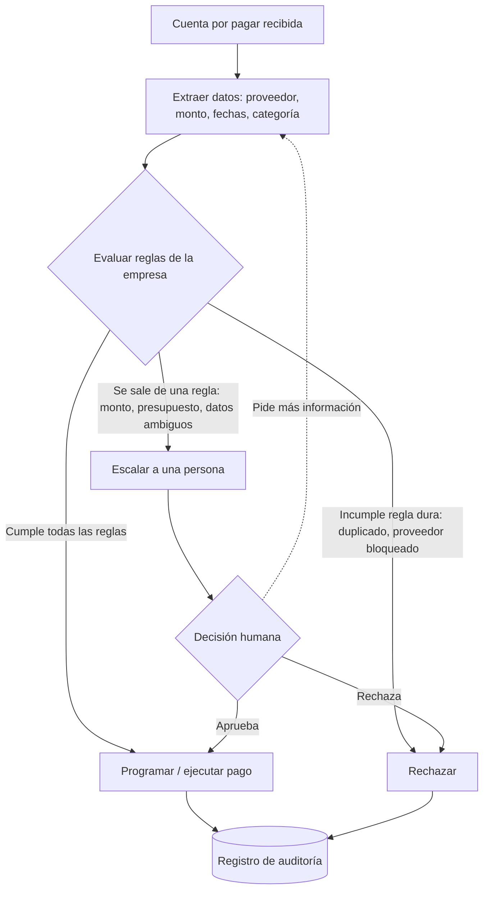

# Blinka – agente de pagos de cuentas por pagar (reto 30X)

> Proyecto del reto 30X Blinka. Estado: **en desarrollo** (por ahora este repositorio contiene documentación; el código todavía no existe).

## Tabla de contenidos

- [El problema](#el-problema)
- [Objetivo](#objetivo)
- [Cómo funciona el agente](#cómo-funciona-el-agente)
- [Diagrama de flujo](#diagrama-de-flujo)
- [Reglas de ejemplo](#reglas-de-ejemplo)
- [Arquitectura propuesta](#arquitectura-propuesta)
- [Roadmap / próximos pasos](#roadmap--próximos-pasos)
- [Seguridad](#seguridad)
- [Estado actual](#estado-actual)

## El problema

Las empresas reciben constantemente cuentas por pagar (facturas de proveedores, servicios, suscripciones, etc.). Revisarlas una por una para decidir cuáles pagar, cuándo y con qué presupuesto consume tiempo, es propenso a errores (pagos duplicados, montos fuera de lo esperado, proveedores no autorizados) y depende de que alguien recuerde todas las políticas internas.

## Objetivo

Construir un agente que revise las cuentas de una empresa y decida cuáles pagar por ella, dentro de las reglas que la empresa define, y que le pida permiso a una persona cuando algo se sale de esas reglas.

En otras palabras, el agente debe:

1. **Automatizar** los pagos que claramente cumplen las reglas de la empresa.
2. **Escalar** a una persona cualquier caso que se salga de esas reglas o que sea ambiguo.
3. **Dejar registro** de cada decisión y de su motivo.

## Cómo funciona el agente

El flujo previsto tiene cinco etapas:

1. **Ingesta de cuentas.** El agente recibe las cuentas por pagar (por ejemplo, facturas en PDF/XML, un CSV o una API) y extrae los datos clave: proveedor, monto, moneda, fecha de emisión, fecha de vencimiento, categoría y número de factura.
2. **Evaluación contra las reglas de la empresa.** Cada cuenta se compara con las reglas que define la empresa, por ejemplo:
   - **Monto máximo** que se puede pagar sin aprobación humana.
   - **Proveedores aprobados** (lista blanca) y proveedores bloqueados.
   - **Fecha de vencimiento**: priorizar lo que vence pronto y no pagar antes de cierta ventana.
   - **Presupuesto por categoría**: no exceder lo asignado a cada categoría en el periodo.
   - **Duplicados**: detectar la misma factura (mismo proveedor + número o mismo monto y fecha) para no pagarla dos veces.
3. **Decisión.** Para cada cuenta el agente decide una de tres acciones:
   - ✅ **Pagar**: cumple todas las reglas.
   - 🙋 **Escalar a una persona**: se sale de alguna regla “suave” (por ejemplo, supera el monto máximo o el presupuesto) o hay información ambigua.
   - ⛔ **Rechazar**: incumple una regla “dura” (por ejemplo, duplicado confirmado o proveedor bloqueado).
4. **Aprobación humana (human-in-the-loop).** Las cuentas escaladas se envían a la persona responsable con un resumen y el motivo. Esa persona aprueba, rechaza o pide más información; el agente no paga nada escalado sin esa respuesta.
5. **Registro de auditoría.** Cada decisión queda registrada: qué cuenta, qué reglas se evaluaron, qué resultado dio cada una, qué decidió el agente (o la persona) y cuándo.

## Diagrama de flujo



## Reglas de ejemplo

> **Ejemplo ilustrativo.** El formato y los valores son una propuesta; cada empresa definiría los suyos.

```yaml
# reglas.yaml (ejemplo)
moneda_base: MXN

limites:
  monto_maximo_sin_aprobacion: 20000      # arriba de esto, escalar
  monto_maximo_absoluto: 250000           # arriba de esto, rechazar

proveedores:
  aprobados:
    - "Proveedor Ejemplo SA de CV"
    - "Servicios Demo SC"
  bloqueados:
    - "Proveedor Bloqueado SA"
  desconocido: escalar                    # proveedor fuera de las listas

vencimiento:
  pagar_dias_antes_de_vencer: 3           # no pagar antes de esta ventana
  vencida: escalar                        # cuentas ya vencidas

presupuesto_mensual_por_categoria:
  software: 50000
  servicios_profesionales: 80000
  oficina: 15000
  al_exceder: escalar

duplicados:
  criterio: [proveedor, numero_factura]
  al_detectar: rechazar

aprobadores:
  - nombre: "Responsable de finanzas"
    canal: email
```

## Arquitectura propuesta

> **Propuesta / próximos pasos.** Nada de esto está implementado todavía; es el plan inicial y puede cambiar.

| Componente | Responsabilidad | Stack propuesto |
|---|---|---|
| Ingesta | Leer cuentas (PDF, XML/CFDI, CSV o API) y normalizarlas | Python, `pydantic` para el modelo de datos |
| Motor de reglas | Evaluar cada cuenta contra `reglas.yaml` de forma determinista | Python, `PyYAML` |
| Agente (LLM) | Extraer datos de documentos poco estructurados y redactar el resumen y el motivo para el aprobador | API de un modelo de lenguaje vía variables de entorno |
| Aprobación humana | Enviar casos escalados y recibir la respuesta (aprobar / rechazar / pedir info) | Email o chat; interfaz web sencilla (p. ej. FastAPI) |
| Pagos | Ejecutar o programar los pagos aprobados | Simulado al inicio; integración real después |
| Auditoría | Guardar cada decisión con sus reglas y motivos | SQLite al inicio, luego PostgreSQL |

Principio de diseño: **las reglas deciden, el LLM asiste.** El modelo ayuda a leer documentos y a explicar, pero la decisión de pagar se toma con reglas deterministas y auditables, y todo lo dudoso se escala a una persona.

## Roadmap / próximos pasos

1. **MVP local:** modelo de datos de cuenta, carga de `reglas.yaml`, motor de reglas y decisiones pagar / escalar / rechazar sobre cuentas de ejemplo en CSV.
2. **Auditoría:** registro de cada decisión en SQLite y reporte simple.
3. **Aprobación humana:** flujo de escalamiento con aprobación / rechazo.
4. **Ingesta con IA:** extracción de datos desde PDF/XML con un LLM y validación de los campos.
5. **Pagos:** integración con un proveedor de pagos o banco (inicialmente en modo simulado).
6. **Pruebas y despliegue:** pruebas automatizadas de las reglas y CI.

## Seguridad

- **Secretos en variables de entorno:** las llaves de API (LLM, pagos, email) nunca se suben al repositorio; se usa un archivo `.env` local ignorado por git y un `.env.example` sin valores reales.
- **Mínimo privilegio:** cada integración usa credenciales con los permisos mínimos necesarios (por ejemplo, tokens de GitHub de grano fino limitados a este repositorio, y llaves de pago restringidas).
- **Nada se paga sin regla o sin persona:** cualquier caso fuera de las reglas requiere aprobación humana explícita.
- **Trazabilidad:** el registro de auditoría permite revisar quién o qué decidió cada pago y por qué.
- **Datos sensibles:** los datos bancarios y de facturas se tratan como confidenciales y no se registran completos en logs.

## Estado actual

- [x] Repositorio creado y flujo de lectura/escritura/PR validado.
- [x] README con la descripción del proyecto.
- [ ] Implementación del agente (ver próximos pasos).
