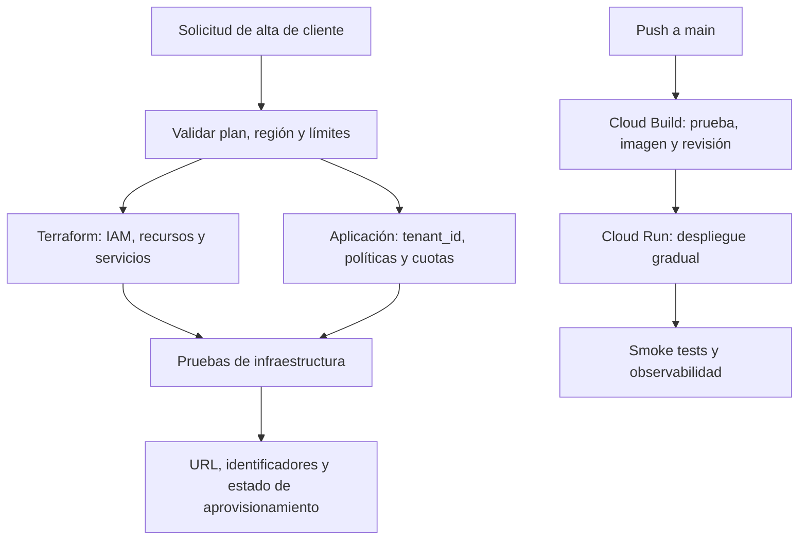

# Know-how: IAM, Cloud Build y Cloud Run en Blinka

Fecha: 18 de octubre de 2026  
Proyecto: `blinka-30x-2026`  
Número de proyecto: `1024016593251`  
Región: `us-central1`

## Propósito

Este documento registra cómo se conectó GitHub con Cloud Build, cómo se asignaron las identidades de Cloud Run y cómo se resolvió el error `iam.serviceAccounts.actAs` durante el despliegue de Blinka.

El procedimiento corresponde a un laboratorio técnico. Para producción se deben reducir los roles amplios, restringir el acceso público y revisar periódicamente las asignaciones IAM.

## Modelo mental de IAM

IAM responde cuatro preguntas:

1. **Quién**: una persona, un grupo o una cuenta de servicio.
2. **Qué puede hacer**: un rol que contiene permisos.
3. **Sobre qué recurso**: proyecto, cuenta de servicio, Cloud Run, Artifact Registry, Firestore, Pub/Sub, etcétera.
4. **Con qué alcance**: permiso heredado desde el proyecto o permiso directo sobre el recurso.

Una asignación IAM se puede leer así:

```text
principal + rol + recurso = autorización
```

Ejemplo de este proyecto:

```text
blinka-cloud-build@blinka-30x-2026.iam.gserviceaccount.com
+ Usuario de cuenta de servicio
+ blinka-worker@blinka-30x-2026.iam.gserviceaccount.com
```

Esto permite que Cloud Build use la identidad `blinka-worker` al crear o actualizar el servicio de Cloud Run.

## Flujo de despliegue

```mermaid
flowchart LR
    G[GitHub<br>push a main] --> T[Cloud Build Trigger<br>blinka-main-deploy]
    T --> B[Cloud Build<br>blinka-cloud-build]
    B --> I[Construye y publica imagen<br>Artifact Registry]
    B -->|iam.serviceAccounts.actAs| D[Default compute service account<br>1024016593251-compute@...]
    B -->|iam.serviceAccounts.actAs| W[blinka-worker@...]
    I --> API[Cloud Run: blinka-api]
    I --> WK[Cloud Run: blinka-worker]
    I --> ADK[Cloud Run: blinka-adk]
    D --> API
    D --> ADK
    W --> WK
```

En `cloudbuild.yaml`:

- `blinka-api` no declara `--service-account`; el error observado identificó la cuenta predeterminada `1024016593251-compute@developer.gserviceaccount.com`.
- `blinka-worker` declara explícitamente `--service-account=blinka-worker@blinka-30x-2026.iam.gserviceaccount.com`.
- `blinka-adk` tampoco declara una cuenta explícita y utiliza la identidad predeterminada del despliegue.
- La imagen se publica en `us-central1-docker.pkg.dev/blinka-30x-2026/blinka/blinka:$COMMIT_SHA`.

## Inventario de identidades

| Identidad | Función | Uso en el despliegue |
|---|---|---|
| `blinka-cloud-build@blinka-30x-2026.iam.gserviceaccount.com` | Cuenta que ejecuta la compilación | Construir, publicar imágenes y desplegar Cloud Run |
| `1024016593251-compute@developer.gserviceaccount.com` | Cuenta predeterminada de Compute | Identidad de `blinka-api` y `blinka-adk` en esta configuración |
| `blinka-worker@blinka-30x-2026.iam.gserviceaccount.com` | Identidad de ejecución del worker | Ejecutar `blinka-worker` en Cloud Run |
| `firebase-adminsdk-fbsvc@blinka-30x-2026.iam.gserviceaccount.com` | Agente de Firebase | No usarlo como identidad de Cloud Build |
| `robertgcits@gmail.com` | Persona administradora | Configurar IAM, Cloud Build y Cloud Run |

Una cuenta de servicio es una identidad técnica. No es una cuenta personal y no debe sustituirse por una clave descargada en el repositorio.

## Permiso crítico: `iam.serviceAccounts.actAs`

Cuando un proceso despliega Cloud Run con una cuenta de servicio, el proceso que despliega debe poder **actuar como** esa cuenta. En Google Cloud Console esto se muestra como el rol **Usuario de cuenta de servicio** (`roles/iam.serviceAccountUser`).

Para este proyecto se necesitan estas asignaciones directas:

| Recurso de cuenta de servicio | Principal que recibe el permiso | Rol |
|---|---|---|
| `1024016593251-compute@developer.gserviceaccount.com` | `blinka-cloud-build@blinka-30x-2026.iam.gserviceaccount.com` | Usuario de cuenta de servicio |
| `blinka-worker@blinka-30x-2026.iam.gserviceaccount.com` | `blinka-cloud-build@blinka-30x-2026.iam.gserviceaccount.com` | Usuario de cuenta de servicio |

La columna **Herencia** debe quedar vacía en esas filas: significa que la asignación fue hecha directamente sobre la cuenta de servicio. No se necesita crear una herencia adicional.

El rol **Editor** heredado desde el proyecto no sustituye a `roles/iam.serviceAccountUser`. Son permisos diferentes y pertenecen a principales diferentes.

## Procedimiento en la consola

### 1. Abrir la cuenta de servicio destino

En Google Cloud Console:

1. Seleccionar el proyecto **Blinka 30X** (`blinka-30x-2026`).
2. Ir a **IAM y administración > Cuentas de servicio**.
3. Abrir la cuenta de servicio destino.
4. Entrar en **Principales con acceso**.

### 2. Conceder el permiso

1. Pulsar **Otorgar acceso**.
2. En **Principal**, escribir el correo completo de `blinka-cloud-build`.
3. En **Rol**, seleccionar **Usuario de cuenta de servicio**.
4. Guardar.
5. Confirmar que aparece una fila con el rol y la herencia vacía.

Repetir el procedimiento para las dos cuentas destino de la tabla anterior. No se debe agregar `blinka-cloud-build` como rol sobre la cuenta que actúa como ejecutora; se agrega como principal sobre cada cuenta que Cloud Build debe usar.

## Errores encontrados y diagnóstico

### Error de registros de Cloud Build

Mensaje observado:

```text
invalid argument: if 'build.service_account' is specified, the build must either
specify 'build.logs_bucket', use REGIONAL_USER_OWNED_BUCKET, or use
CLOUD_LOGGING_ONLY / NONE logging options
```

Corrección aplicada en la raíz de `cloudbuild.yaml`:

```yaml
options:
  logging: CLOUD_LOGGING_ONLY
```

La configuración permite que el trigger use la cuenta de servicio personalizada y envíe los registros a Cloud Logging.

### Error de impersonación de cuenta de servicio

Mensaje observado:

```text
PERMISSION_DENIED: Permission 'iam.serviceAccounts.actAs' denied on service account
1024016593251-compute@developer.gserviceaccount.com
```

Interpretación:

- La compilación sí pudo construir y publicar la imagen.
- El fallo ocurrió al intentar desplegar `blinka-api`.
- El problema no era `gcr.io`, Docker ni Artifact Registry.
- Faltaba que `blinka-cloud-build` tuviera el rol **Usuario de cuenta de servicio** sobre la cuenta predeterminada.

Después de corregir la primera cuenta, también se debe configurar la cuenta `blinka-worker`, porque el paso de despliegue del worker la declara explícitamente.

## Validación posterior

Después de guardar los permisos:

1. Ir a **Cloud Build > Historial**.
2. Abrir la compilación fallida `7d072b80`.
3. Pulsar **Reintentar compilación**.
4. Verificar que los pasos de Docker terminen correctamente.
5. Confirmar que se desplieguen, en orden, `blinka-api`, `blinka-worker` y `blinka-adk`.
6. Si aparece otro error, abrir el paso rojo y copiar el mensaje completo; el estado rojo de la lista por sí solo no identifica la causa.

Una compilación correcta debe mostrar los pasos en verde y los servicios disponibles en Cloud Run en `us-central1`.

## Evidencia de compilación exitosa

La configuración se validó con la compilación:

- **Build ID:** `587fd4ca-c923-4a29-9490-6011085b7559`
- **Trigger:** `blinka-main-deploy`
- **Rama:** `main`
- **Región:** `us-central1`
- **Resultado:** correcta, cinco pasos en verde
- **Duración observada:** 2 min 17 s
- **Worker:** revisión `blinka-worker-00010-2xh`, sirviendo el 100 % del tráfico
- **ADK:** revisión `blinka-adk-00007-2r6`, sirviendo el 100 % del tráfico
- **URL observada del worker:** `https://blinka-worker-1024016593251.us-central1.run.app`

La evidencia confirma que el problema de IAM quedó resuelto y que Cloud Build pudo construir, publicar y desplegar los servicios. Todavía conviene ejecutar pruebas funcionales sobre las URLs antes de considerar cerrado el despliegue operativo.

## Lectura correcta de la pantalla de cuentas de servicio

- **Correo electrónico**: identificador que se usa al asignar permisos.
- **Nombre**: etiqueta humana de la cuenta; puede ser diferente del correo.
- **ID de cliente de OAuth 2**: identificador numérico de OAuth; no es el Project ID y no se usa para asignar este permiso.
- **ID numérico de la cuenta**: identificador interno de Google; no se copia en el campo Principal.
- **Herencia**: indica si el rol viene del proyecto u otro nivel superior.
- **Principales con acceso**: personas o cuentas que pueden usar o administrar esa cuenta de servicio.

Para esta corrección se copia siempre el correo completo, por ejemplo:

```text
blinka-cloud-build@blinka-30x-2026.iam.gserviceaccount.com
```

## Buenas prácticas para la siguiente iteración

- Sustituir el rol **Editor** amplio por roles específicos cuando el laboratorio termine.
- Mantener una cuenta separada para construir (`blinka-cloud-build`) y otra para ejecutar el worker (`blinka-worker`).
- No descargar claves JSON ni subir secretos a GitHub.
- Revisar periódicamente los roles directos y los heredados.
- Mantener `--allow-unauthenticated` solo mientras el demo lo requiera; para producción, proteger la API y ADK con autenticación.
- Usar una cuenta de servicio administrada por el usuario para el trigger y documentar qué recursos puede modificar.

## Automatización y modelo de plataforma como servicio

Sí, este procedimiento se puede automatizar. Lo que se hizo en la consola es una parte del aprovisionamiento de una plataforma: crear identidades, asignar permisos, preparar el registro de imágenes, desplegar servicios y validar el resultado.

La separación recomendada es:

| Capa | Responsabilidad | Herramienta adecuada |
|---|---|---|
| Infraestructura | APIs, Artifact Registry, cuentas de servicio, IAM, Firestore, Pub/Sub y Cloud Run | Terraform u OpenTofu |
| Integración continua | Compilar, probar, construir la imagen y publicar una revisión | Cloud Build y `cloudbuild.yaml` |
| Aplicación | Crear el espacio del cliente, políticas, usuarios, cuotas y datos | API de Blinka y Firestore |

Terraform conserva el estado deseado de la infraestructura; `cloudbuild.yaml` describe el trabajo de una compilación. No son sustitutos: uno aprovisiona recursos y el otro entrega una versión de la aplicación.

### Qué significa cada “espacio”

- **Proyecto GCP**: frontera de facturación, cuotas e IAM. No se crea por cada factura o sesión.
- **Entorno**: normalmente `dev`, `staging` o `prod`; puede tener un proyecto separado.
- **Tenant o espacio de cliente**: frontera lógica dentro de la aplicación, con un `tenant_id`, usuarios, políticas y datos aislados.
- **Servicio Cloud Run**: endpoint estable, por ejemplo `blinka-api`.
- **Revisión**: versión inmutable producida por una imagen concreta.
- **Instancia**: réplica temporal del contenedor; Cloud Run la crea y elimina según la carga.
- **Compilación**: ejecución del pipeline que produce una imagen y despliega revisiones.

Para Blinka, la primera evolución razonable es mantener un proyecto `blinka-30x-2026`, separar ambientes cuando sea necesario y crear los espacios de clientes como registros aislados en Firestore. Un proyecto GCP por cliente ofrece mayor aislamiento, pero también exige más automatización, permisos de organización, facturación y operación. Se reserva para requisitos de seguridad, cumplimiento o aislamiento fuerte.

### Flujo automatizado futuro



Para automatizar el permiso que se corrigió manualmente se puede usar la CLI dentro de un pipeline:

```bash
gcloud iam service-accounts add-iam-policy-binding \
  1024016593251-compute@developer.gserviceaccount.com \
  --member="serviceAccount:blinka-cloud-build@blinka-30x-2026.iam.gserviceaccount.com" \
  --role="roles/iam.serviceAccountUser" \
  --project=blinka-30x-2026

gcloud iam service-accounts add-iam-policy-binding \
  blinka-worker@blinka-30x-2026.iam.gserviceaccount.com \
  --member="serviceAccount:blinka-cloud-build@blinka-30x-2026.iam.gserviceaccount.com" \
  --role="roles/iam.serviceAccountUser" \
  --project=blinka-30x-2026
```

Para una plataforma mantenible, esas asignaciones deben pasar a Terraform y revisarse mediante `plan` antes de aplicar cambios. Cloud Run permite declarar la identidad del servicio en Terraform y Google recomienda identidades administradas por el usuario con permisos mínimos para producción. [Identidad de servicio de Cloud Run](https://docs.cloud.google.com/run/docs/configuring/services/service-identity), [autenticación de Terraform](https://docs.cloud.google.com/docs/terraform/authentication).

## Lista de comprobación

- [x] GitHub conectado a Cloud Build.
- [x] Trigger `blinka-main-deploy` configurado para la rama `main`.
- [x] Imagen publicada en Artifact Registry.
- [x] `options.logging: CLOUD_LOGGING_ONLY` en `cloudbuild.yaml`.
- [x] `blinka-cloud-build` con **Usuario de cuenta de servicio** sobre la cuenta predeterminada.
- [x] `blinka-cloud-build` con **Usuario de cuenta de servicio** sobre `blinka-worker`.
- [x] Reintentar la compilación y confirmar los tres servicios en verde: build `587fd4ca-c923-4a29-9490-6011085b7559`.
- [ ] Ejecutar smoke tests sobre API, worker y ADK Web.
- [ ] Revisar y reducir los roles amplios antes de un uso productivo.

## Referencias oficiales

- [Administrar acceso a cuentas de servicio](https://docs.cloud.google.com/iam/docs/manage-access-service-accounts)
- [Roles para autenticación de cuentas de servicio](https://docs.cloud.google.com/iam/docs/service-account-permissions)
- [Desplegar compilaciones a Cloud Run](https://docs.cloud.google.com/build/docs/deploying-builds/deploy-cloud-run)
- [Crear y administrar triggers de Cloud Build](https://docs.cloud.google.com/build/docs/automating-builds/create-manage-triggers)
