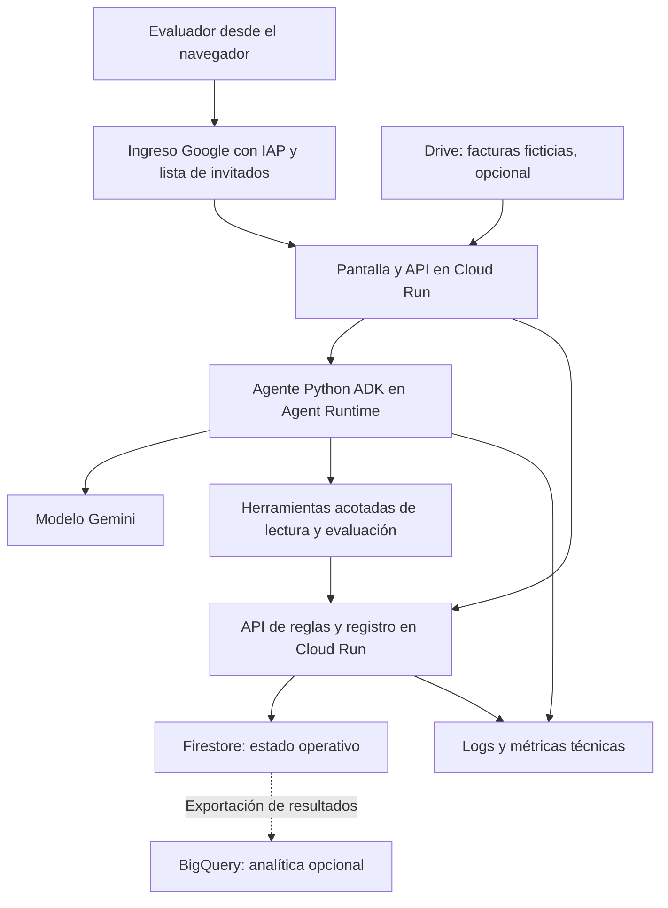

# Demo Blinka en línea: arquitectura GCP y contrato de APIs

Fecha de consulta técnica: 17 de octubre de 2026. Estado: propuesta de arquitectura; sin recursos creados, despliegue ni pruebas de nube ejecutadas.

## 1. Decisión propuesta

Publicar una pantalla web accesible por URL, respaldada por un agente **Python con ADK 2.x**, un servicio de reglas y una base de datos transaccional. El proyecto de Google Cloud se asociará a la cuenta de facturación por consumo del usuario. Se conserva el alcance del reto: únicamente datos ficticios y decisiones simuladas PAGAR/FRENAR/ESCALAR.

La arquitectura de referencia usa **Agent Runtime de Agent Platform para el agente**, **Cloud Run para la pantalla y API**, y **Firestore para el estado operativo**. Drive se puede incorporar como entrada documental; BigQuery, como salida analítica. No es necesario incorporar ambos conectores para tener el primer demo en línea.

Esta propuesta complementa la [especificación funcional](reto-blinka-especificacion-demo.md). Alojar el demo en línea es una elección del proyecto a petición del usuario; no cambia las exclusiones de pagos, identidad empresarial, fraude o cumplimiento del reto.

## 2. Qué significa cada tecnología

| Elemento | Responsabilidad en la propuesta | Lo que no sustituye |
|---|---|---|
| Proyecto GCP y facturación por consumo | Agrupar recursos, permisos, cuotas y consumo del demo | No crea por sí mismo el agente o sus reglas. |
| ADK 2.x | Implementar el flujo del agente, sus herramientas y su interacción con el modelo | No es el hosting ni una garantía de decisiones financieras correctas. |
| Modelo Gemini en Agent Platform | Extraer información de facturas y apoyar explicaciones basadas en evidencias | No puede concederse permisos ni saltarse reglas. |
| Agent Runtime | Ejecutar el agente en un entorno administrado | No sustituye la pantalla de reglas y resultados del reto. |
| Cloud Run | Publicar interfaz y API de negocio; ejecutar las comprobaciones deterministas | No conserva de forma durable el presupuesto en variables del proceso. |
| Firestore | Conservar facturas, políticas, acuerdos, presupuesto, aprobaciones e historial | No necesita actuar como almacén analítico corporativo. |
| Drive, opcional | Importar facturas sintéticas desde archivos seleccionados | No es el registro transaccional de aprobaciones. |
| BigQuery, opcional | Analizar históricos, métricas, comparativas y rankings | No es la base elegida para resolver cada aprobación interactiva. |

La documentación oficial confirma ADK 2.0 para Python y TypeScript, con flujos basados en grafos. La disponibilidad del lenguaje en ADK no implica que todas las rutas de despliegue tengan idéntico soporte. [ADK 2.0](https://adk.dev/2.0/).

Google documenta el despliegue estándar de Agent Runtime para Python y Go; para este proyecto se propone Python por esa ruta directa. TypeScript también es una opción para alojar el agente en Cloud Run, y puede utilizarse independientemente en la interfaz. [Agent Runtime](https://adk.dev/deploy/agent-runtime/deploy/), [ADK en Cloud Run](https://adk.dev/deploy/cloud-run/).

Los nombres actuales de la documentación son Agent Platform y Agent Runtime. Algunas APIs, recursos y comandos conservan identificadores como `aiplatform`, `reasoningEngines` o `agent_engine`. Se deben seguir los identificadores documentados, sin deducir un endpoint nuevo a partir del nombre comercial. [Acceso a Agent Platform](https://docs.cloud.google.com/gemini-enterprise-agent-platform/machine-learning/general/googleapi-access-methods), [despliegue estándar](https://adk.dev/deploy/agent-runtime/deploy/).

## 3. Dos rutas válidas para publicar

| Criterio | A. ADK dentro de Cloud Run | B. ADK en Agent Runtime + Cloud Run |
|---|---|---|
| Ubicación del agente | En el servicio de la aplicación | En el runtime administrado de agentes |
| Pantalla y API | Cloud Run | Cloud Run |
| Reglas y datos | Evaluador determinista + Firestore | Evaluador determinista + Firestore |
| Modelo | Gemini mediante la API de Agent Platform | Gemini mediante la API de Agent Platform |
| Integración inicial | Menos servicios que coordinar | Hay que conectar API web y runtime |
| Separación de despliegues | Se puede empezar con un solo servicio | Agente y aplicación evolucionan por separado |
| Ajuste al objetivo | Ruta práctica para obtener una URL cuanto antes | Ruta de referencia si se quiere probar específicamente Agent Runtime |

**Elección propuesta para esta conversación: B**, por el interés expresado en Agent Platform. La ruta A sigue siendo una alternativa para reducir el trabajo inicial, y también permite crecer. No se propone desplegar ambas ni incorporar Kubernetes para el demo. El uso de Cloud Run como destino de ADK está documentado oficialmente. [Guía de despliegue](https://docs.cloud.google.com/run/docs/ai/build-and-deploy-ai-agents/deploy-adk-agent).

No se afirma que una ruta sea más barata sin medir el patrón de uso. La comparación anterior es de organización y complejidad de nuestra implementación.

## 4. Arquitectura de referencia

La pantalla, la API pública de negocio y los endpoints internos pueden formar parte de una misma aplicación Cloud Run inicialmente, con autorización por ruta. No hace falta convertir cada cuadro del diagrama en un microservicio.

### Recorrido de una factura

1. El evaluador entra por la URL y abre su espacio de prueba con una empresa ficticia.
2. Configura reglas y carga una factura de texto; opcionalmente importa un archivo sintético de Drive.
3. La aplicación conserva la entrada original e invoca al agente con una referencia al caso.
4. El agente extrae los campos y usa herramientas acotadas para obtener reglas y acuerdos. Los campos ambiguos se señalan para revisión.
5. La API determinista contrasta los datos con referencias y política; consulta duplicados y presupuesto vigente.
6. Si corresponde aprobar, la API registra decisión y compromiso presupuestal en una sola transacción. Si corresponde frenar o escalar, conserva la explicación sin comprometer presupuesto.
7. La pantalla muestra el resultado persistido por la API, no una decisión alternativa redactada por el modelo.
8. Una persona resuelve las excepciones admisibles desde la pantalla. La API comprueba su identidad, el alcance del permiso y el presupuesto actual antes de autorizar.

Las sesiones conversacionales del agente y el historial de negocio tienen responsabilidades diferentes: perder o reiniciar una conversación no puede borrar una aprobación, un duplicado o un compromiso presupuestal.

## 5. Drive, Firestore y BigQuery: funciones diferentes

**Drive.** Se propone como entrada opcional porque facilita compartir facturas ficticias. La primera integración debe importar archivos seleccionados o limitarse a una carpeta exclusiva del demo. Para selección de archivos por el usuario, Google recomienda el alcance `drive.file`. El alcance OAuth y los permisos del archivo son controles diferentes; habilitar la API no concede acceso automático a todo el Drive. [Permisos de Drive](https://developers.google.com/workspace/drive/api/guides/api-specific-auth).

**Firestore.** Es la base propuesta para cambiar de estado de forma consistente. Una transacción debe comprobar y registrar conjuntamente la aprobación, la identidad del cobro y el presupuesto. El trabajo con el modelo se realiza fuera de esa transacción, porque Firestore puede reintentar la función cuando hay conflictos. [Transacciones de Firestore](https://firebase.google.com/docs/firestore/manage-data/transactions).

**BigQuery.** Se propone para consultas de históricos y métricas. BigQuery sí dispone de transacciones; la razón para no elegirlo como base operativa es su orientación analítica y la recomendación de Google de evitar DML de una sola fila como patrón OLTP. Esta es una decisión de adecuación al caso, no una afirmación de que BigQuery carezca de consistencia. [Recomendaciones de BigQuery](https://docs.cloud.google.com/bigquery/docs/best-practices-performance-compute), [transacciones](https://docs.cloud.google.com/bigquery/docs/transactions).

Si posteriormente se requiere un modelo relacional con restricciones SQL, se puede evaluar Cloud SQL como alternativa a Firestore. No se propone operar ambas bases en el demo.

### Datos operativos mínimos propuestos

| Registro | Identificación y contenido |
|---|---|
| Espacio de prueba | ID interno y acceso asignado al evaluador. |
| Política | ID, versión, umbrales, beneficiarios y periodo. |
| Acuerdo | Beneficiario, importe y moneda pactados. |
| Factura | ID, revisión, documento original y campos extraídos con evidencia. |
| Identidad de cobro | Clave normalizada de beneficiario y número de factura; referencia al original. |
| Presupuesto | Espacio, empresa ficticia, periodo, moneda, total y comprometido. |
| Solicitud de aprobación | Factura, revisión y condiciones que requieren permiso. |
| Respuesta humana | Identidad validada, fecha, permiso o rechazo y alcance. |
| Decisión | Datos utilizados, política, resultado, motivos, presupuesto antes/después y momento. |

El espacio de prueba mantiene separados los presupuestos de distintos evaluadores. Es aislamiento para demostrar el reto, no una ampliación hacia un producto multiempresa completo.

## 6. APIs de Google a considerar

La siguiente es una lista de servicios para la arquitectura propuesta, no un comando de activación indiscriminada. Solo se habilitan los correspondientes a los componentes elegidos.

| API / servicio | Identificador | Uso previsto | Momento |
|---|---|---|---|
| Agent Platform | `aiplatform.googleapis.com` | Modelo Gemini y Agent Runtime | Núcleo |
| Cloud Run Admin | `run.googleapis.com` | Publicar pantalla y API | Núcleo |
| Firestore | `firestore.googleapis.com` | Estado transaccional | Núcleo |
| Cloud Storage | `storage.googleapis.com` | Artefactos de despliegue y archivos si se usan | Según empaquetado e ingreso |
| Cloud Build | `cloudbuild.googleapis.com` | Construcción en Google Cloud | Si se construye allí |
| Artifact Registry | `artifactregistry.googleapis.com` | Imágenes o artefactos del despliegue | Según despliegue |
| IAM | `iam.googleapis.com` | Identidades de servicio y permisos | Configuración de infraestructura |
| Identity-Aware Proxy | `iap.googleapis.com` | Acceso de evaluadores invitados | Acceso controlado propuesto |
| Cloud Logging | `logging.googleapis.com` | Logs operativos | Núcleo de observación |
| Cloud Monitoring | `monitoring.googleapis.com` | Métricas y alertas técnicas | Observación |
| Google Drive | `drive.googleapis.com` | Importación documental | Opcional |
| BigQuery | `bigquery.googleapis.com` | Histórico analítico | Opcional |
| Secret Manager | `secretmanager.googleapis.com` | Secretos del conector si resultan necesarios | Condicional |

Los requisitos de proyecto y facturación se describen en el [inicio rápido de Agent Runtime](https://docs.cloud.google.com/gemini-enterprise-agent-platform/build/runtime/quickstart-adk). La infraestructura de publicación y observación utiliza los servicios documentados para [Cloud Run](https://docs.cloud.google.com/run/docs/monitoring-managed-prometheus-sidecar). Esta propuesta no necesita ese sidecar; la referencia permite verificar los identificadores de los servicios.

La integración entre servicios debe usar sus identidades de servicio. No se distribuyen claves del modelo o credenciales del proyecto al navegador. La aplicación tendrá permisos de datos; el agente no necesita permisos para modificar IAM, facturación o configuración de infraestructura.

## 7. API de negocio que construiríamos

Estas rutas son **contratos propuestos de nuestra aplicación**, no endpoints existentes de Google ni APIs ya implementadas. Prefijo común: `/api/v1`. El espacio de prueba se obtiene de la sesión validada; un parámetro del usuario no basta para acceder a otro espacio.

| Método y ruta | Entrada principal | Resultado | Quién puede usarla |
|---|---|---|---|
| `GET /policies/current` | Contexto de sesión | Política vigente y versión | Evaluador autorizado |
| `PUT /policies/current` | Reglas y versión previa esperada | Nueva versión validada | Configurador del espacio |
| `POST /invoices` | Texto sintético y metadatos de origen | Factura y revisión identificadas | Evaluador autorizado |
| `PATCH /invoices/{id}` | Corrección de factura no aprobada y revisión previa esperada | Nueva revisión del mismo caso; permisos anteriores invalidados | Evaluador autorizado |
| `POST /invoices/{id}/evaluations` | Revisión esperada y clave de repetición | Decisión persistida y explicación | Evaluador autorizado |
| `GET /invoices` | Filtros de estado y paginación | Lista de facturas del espacio | Evaluador autorizado |
| `GET /invoices/{id}` | ID | Datos, fuente, estado y decisiones | Evaluador autorizado |
| `GET /approval-requests` | Estado y paginación | Pendientes que la persona puede resolver | Aprobador autorizado |
| `POST /approval-requests/{id}/responses` | Autorizar/rechazar, excepciones y revisión esperada | Respuesta registrada y resultado de reevaluación | Persona aprobadora; nunca el modelo |
| `GET /decisions/{id}` | ID | Registro histórico y explicación | Evaluador autorizado |
| `GET /metrics` | Conjunto o ejecución identificados | Métricas de decisiones; exactitud solo si existen etiquetas esperadas | Evaluador autorizado |
| `POST /imports/drive` | ID de archivo previamente autorizado | Factura importada y referencia al origen | Usuario con acceso al archivo; opcional |

### Reglas del contrato

- Las operaciones que generan decisiones aceptan una clave de repetición para que reintentar la misma solicitud no cree una segunda aprobación. Reutilizar la clave con un contenido diferente produce conflicto.
- Los cambios usan la revisión o versión esperada. Si ya cambió, se devuelve conflicto y se requiere leer el estado nuevo.
- El cliente no envía como autoridad `decision=PAGAR`, `approved=true`, el saldo disponible o una identidad humana arbitraria. La API calcula o verifica esos datos.
- Una respuesta humana identifica exactamente las excepciones autorizadas. Un permiso para importe no autoriza por sí mismo un beneficiario nuevo.
- El permiso humano se valida contra factura, revisión, política y periodo vigentes. La API revalida duplicidad, acuerdo, datos y presupuesto.
- El procesamiento inicial puede ser síncrono para una factura. Si luego se vuelve asíncrono, se incorpora un recurso de trabajo con estado y consulta; no se devuelve una aprobación antes de persistirla.
- Un error técnico o un fallo del modelo nunca se presenta como PAGAR. Se informa el fallo sin inventar una decisión satisfactoria; si falta información evaluable, se registra ESCALAR conforme a la política.
- Se proponen respuestas HTTP `401/403` para acceso no válido, `409` para revisión o repetición conflictiva y `422` para datos o configuración inválidos. Un FRENAR de negocio es un resultado válido de evaluación, no necesariamente un error HTTP.

### Herramientas disponibles para el agente

| Herramienta lógica | Autoridad permitida |
|---|---|
| `read_invoice(invoice_id)` | Leer la factura autorizada para la ejecución. |
| `get_policy_context(invoice_id)` | Consultar reglas y referencias pertinentes. |
| `submit_extraction(invoice_id, revision, fields, evidence)` | Proponer campos; el backend valida estructura y referencias. |
| `evaluate_invoice(invoice_id, revision)` | Solicitar evaluación determinista; no elegir el resultado. |
| `read_decision(decision_id)` | Consultar el resultado y explicar sus razones. |

El agente no recibe herramientas para aprobar en nombre de una persona, aumentar el presupuesto, editar la lista permitida, ejecutar SQL libre sobre datos operativos o mover dinero. Las herramientas internas usan una identidad autenticada de servicio y autorización por operación; ocultarlas en la interfaz no constituye protección suficiente.

## 8. Cómo hacer que crezca sin romper las reglas

1. **Servicios sin estado local:** las instancias comparten Firestore y no guardan el presupuesto en memoria o archivos temporales. Cloud Run puede escalar y detener instancias; su disco local no es persistente. [Contrato de ejecución](https://docs.cloud.google.com/run/docs/container-contract).
2. **Transacción por autorización:** aprobar y comprometer presupuesto ocurre de forma indivisible. El paralelismo no debe producir sobregiro simulado ni duplicados. El modelo se invoca fuera de la transacción.
3. **Separación de presupuesto:** usar claves por espacio, empresa ficticia, periodo y moneda. Un único contador para todos los evaluadores crearía interferencias.
4. **Concurrencia probada:** dos facturas de USD 700 y USD 600 frente a USD 1,000 disponibles no pueden terminar ambas aprobadas. No se promete cuál gana salvo que el lote declare un orden.
5. **Orden explícito en lotes:** los lotes del conjunto de aceptación se procesan en su orden declarado. Las solicitudes independientes concurrentes se validan contra el estado vigente al registrar la decisión.
6. **Controles de volumen:** limitar entradas por evaluador, tamaño documental, pasos del agente y solicitudes simultáneas. Más instancias no corrigen un bucle del agente ni amplían cuotas del modelo.
7. **Analítica fuera de la decisión:** si se conecta BigQuery, exportar eventos identificados y tolerar retraso. Un fallo de exportación no debe volver a autorizar ni duplicar consumo. La API consulta Firestore para el estado vigente.
8. **Crecimiento medido:** si un presupuesto recibe demasiadas escrituras concurrentes, medir la contención y serializar esa partición o reconsiderar la base. No dividir un presupuesto de manera que permita exceder su límite.

Firestore documenta el comportamiento de contención y aislamiento. Su uso no equivale a capacidad ilimitada sobre un solo documento. [Contención transaccional](https://firebase.google.com/docs/firestore/transaction-data-contention).

Cloud Run escala según la carga y permite configurar mínimos, máximos y concurrencia. Para la aplicación web del demo se propone mínimo 0 fuera de las sesiones de presentación y un máximo inicial pequeño, sujeto a pruebas. Estos parámetros son de Cloud Run; no se asume que Agent Runtime tenga idénticos valores o facturación. [Escalado de Cloud Run](https://docs.cloud.google.com/run/docs/about-instance-autoscaling).

## 9. Acceso en línea y presupuesto de infraestructura

El usuario confirmó **acceso controlado para evaluadores invitados**. La URL no exige dominio personalizado. El ingreso debe identificar al evaluador y permitir que la API compruebe su espacio y permisos. La lista de invitados se configura fuera del alcance de modificación del agente.

Se propone IAP directamente en Cloud Run para el ingreso con cuentas Google. Para invitados externos o un proyecto sin organización, se configura el cliente OAuth correspondiente. Las llamadas del agente a la API requieren acceso programático de IAP y autorización limitada a sus herramientas; no basta con asumir que la autenticación de Cloud Run atraviesa IAP sin configuración. La API verifica la identidad recibida y distingue personas de identidades de servicio. [IAP en Cloud Run](https://docs.cloud.google.com/run/docs/securing/identity-aware-proxy-cloud-run), [acceso programático y clientes OAuth](https://docs.cloud.google.com/iap/docs/custom-oauth-configuration).

Si se elige acceso público, cada visitante debe tener una sesión de prueba aislada con datos ficticios y límites de uso. Esa modalidad agrega trabajo de aislamiento y control de consumo; no cambia las reglas de decisión del reto.

La identidad del servicio del agente no puede sustituir a la identidad humana que autoriza una excepción. Los SDK de servidor de Firestore usan IAM y no aplican las Security Rules del cliente; la autorización por espacio y operación se implementa en la API. [Bibliotecas de servidor de Firestore](https://firebase.google.com/docs/firestore/client/libraries).

El gasto a estimar comprende invocaciones del modelo, ejecución del agente y aplicación, sesiones si aplican, operaciones y almacenamiento, construcción de artefactos y observación. Drive y BigQuery solo se suman si se incorporan. No se fija una cifra sin elegir modelo, región, cantidad de pruebas y presupuesto autorizado.

Configurar alertas de presupuesto ayuda a observar el consumo, pero un presupuesto de solo alertas no lo detiene. Google también documenta spend cap budgets para servicios elegibles; se debe comprobar su cobertura concreta, no asumir un tope universal para el proyecto. [Alertas de presupuesto](https://docs.cloud.google.com/billing/docs/how-to/budgets), [spend caps](https://docs.cloud.google.com/billing/docs/how-to/budgets-spend-caps).

Los máximos de instancias ayudan a controlar recursos; no son un límite monetario garantizado y pueden superarse brevemente en determinadas circunstancias. [Máximos de Cloud Run](https://docs.cloud.google.com/run/docs/configuring/max-instances).

El presupuesto de infraestructura GCP y el presupuesto de pagos ficticios de la empresa son registros separados. Los USD 10,000 de DEMO-v1 no representan autorización de gasto en la nube.

## 10. Alcance de la primera publicación

| Construir para la primera versión | Conectar después si aporta valor |
|---|---|
| Pantalla accesible por URL | Google Drive como fuente documental |
| Agente ADK y modelo configurado | BigQuery para análisis histórico |
| Reglas deterministas y Firestore | Procesamiento de lotes mediante cola si la carga lo requiere |
| Entrada de texto y set de facturas sintéticas | Otros formatos documentales |
| Pendientes y respuesta humana validada | Nuevos espacios o empresas fuera de los evaluadores del demo |
| Historial persistente y pruebas del reto | Mejoras operativas justificadas por mediciones |

No se necesita una arquitectura multiagente para demostrar el flujo. Un agente con herramientas acotadas y funciones deterministas puede cumplirlo.

## 11. Criterios para considerar publicado el demo

- Existe una URL que los evaluadores previstos pueden abrir y utilizar.
- La pantalla permite cambiar reglas y procesa facturas sintéticas con el agente desplegado.
- Las decisiones y explicaciones persisten al recargar y al cambiar de instancia.
- Las aprobaciones humanas conservan su identidad y alcance; el agente no puede suplantarlas.
- Los 22 casos funcionales definidos tienen resultados obtenidos registrados.
- Se agregan comprobaciones de concurrencia, reintentos, separación entre evaluadores y recuperación tras un fallo técnico.
- Los límites de consumo y el registro técnico permiten observar el uso de la infraestructura.
- No hay ejecución financiera ni uso de datos reales de clientes o empresas.

## 12. Resultado de esta etapa y datos pendientes de infraestructura

**Obtenido:** arquitectura propuesta, alternativas de hosting, separación de datos, inventario de APIs, contrato de rutas y controles para concurrencia. Se consultó documentación oficial actual.

**No obtenido todavía:** proyecto provisionado, APIs habilitadas, código implementado, URL publicada, conexión a Drive/BigQuery o pruebas ejecutadas en Google Cloud.

Para concretar el despliegue faltan el ID del proyecto existente o la elección de uno nuevo, su asociación de facturación, el presupuesto de infraestructura y la lista de invitados. La modalidad de acceso controlado ya está confirmada. Región y modelo se eligen verificando disponibilidad conjunta en ese proyecto. No se requieren claves ni contraseñas pegadas en una conversación.
