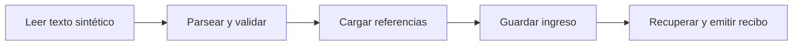
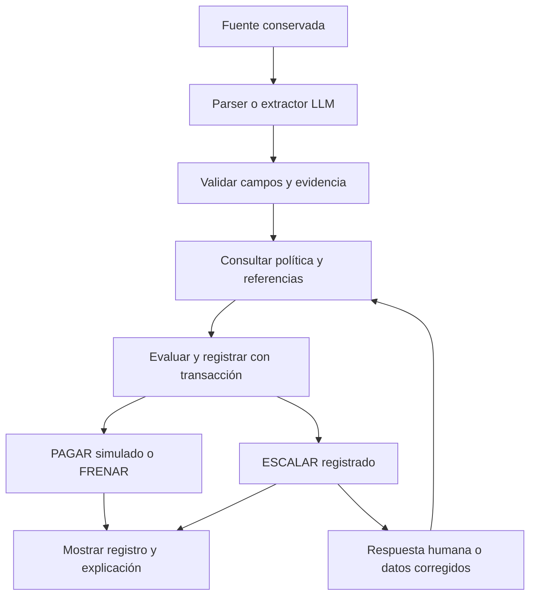

# Blinka: fases de desarrollo y madurez del agente ADK

Estado: diseño de implementación con F0/F1 y el núcleo F2 ejecutados localmente. F3–F5 siguen siendo etapas de evolución.

## 1. Orden de construcción

**Estructurar → leer → validar → cargar referencias → guardar y recuperar → comparar → determinar y registrar → resolver excepciones → incorporar LLM → publicar.**

ADK está presente desde la primera estructura ejecutable. El código de negocio permanece independiente de ADK. El primer flujo utiliza funciones programáticas; el modelo se incorpora posteriormente para interpretar entradas menos estructuradas.

ADK 2.0 permite componer grafos con funciones de código sin invocar un modelo. La documentación Python muestra `Workflow` como punto de entrada `root_agent`. Esto permite empezar con una ejecución real del framework sin simular una llamada al LLM. [Grafos de ADK](https://adk.dev/graphs/).

El [prompt para iniciar la implementación](prompts/scaffold-determinista-adk.md) está acotado a **F0 y F1**. F2 se añadió después como motor determinista y workflow ADK separado; F3–F5 siguen siendo el plan de evolución.

## 2. Qué es programático, qué corresponde al LLM y qué es humano

| Capacidad | Código determinista | LLM | Persona |
|---|---|---|---|
| Recibir texto o archivo | Identifica, limita formato, lee y conserva la fuente | No necesario | Ingresa una factura ficticia |
| Leer un formato sintético conocido | Parser explícito de campos | No necesario | Corrige si corresponde |
| Interpretar texto libre | Valida estructura, evidencia y ambigüedades | Propone campos extraídos | Aclara información incierta |
| Cargar políticas y acuerdos | Consulta versiones e identificadores | Puede solicitar la consulta mediante una herramienta | Define o modifica configuración |
| Guardar y recuperar información | Persistencia y control de revisiones | No decide qué controles omitir | Consulta resultados |
| Comparar con acuerdo y beneficiarios | Comparaciones exactas con referencias | No decide equivalencias comerciales por intuición | Corrige referencias legítimamente |
| Calcular límites y presupuesto | Aritmética exacta y transacciones | No calcula la autorización | Puede configurar el presupuesto |
| Determinar PAGAR/FRENAR/ESCALAR | Motor de reglas | No tiene autoridad para cambiar el resultado | Autoriza solo excepciones admitidas |
| Explicar | Plantilla con datos y reglas comprobados | Redacción opcional a partir del registro | Lee y verifica la explicación |
| Aprobar una excepción | Comprueba identidad, alcance y condiciones vigentes | No suplanta a la persona | Autoriza o rechaza |

**Determinar que una factura cumple las reglas es programático. Autorizar una excepción es humano. Interpretar una factura de texto libre puede requerir un LLM.** Son responsabilidades distintas.

## 3. Fases y criterios de madurez

Las etiquetas M0–M5 son una clasificación propuesta para este proyecto; no pertenecen a una escala oficial de Google o Blinka.

| Fase | Madurez al superar las pruebas | Capacidad entregada | Uso de ADK | Uso del LLM | Evidencia para avanzar |
|---|---|---|---|---|---|
| F0 | M0: base ejecutable | Paquete, configuración, modelos y punto de entrada | Importación y construcción de un grafo mínimo | Ninguno | Entorno reproducible; SDK y entrada verificados |
| F1 | M1: lectura y memoria local | Lee, valida, carga referencias, guarda y recupera | Grafo de funciones de ingreso | Ninguno | Datos recuperados tras reiniciar; fuente conservada; reintento sin duplicar |
| F2 | M2: decisión bajo reglas | Compara y produce PAGAR/FRENAR/ESCALAR con registro | Nodos invocan el servicio determinista | Ninguno | Casos normales/trampa y límites correctos; presupuesto atómico |
| F3 | M3: excepciones controladas | Solicita y registra respuesta humana; reevalúa | Pausa/reanudación vinculada a solicitud persistente | Ninguno | Rechazo, permiso parcial, permiso obsoleto y cambio de presupuesto comprobados |
| F4 | M4: lectura asistida por modelo | Extrae campos de texto libre y los valida | Nodo de extracción con modelo; mismas reglas posteriores | Solo extracción; explicación opcional | Extracción comparada con evidencia; errores o ambigüedades no autoaprueban |
| F5 | M5: demo en línea para invitados | API, pantalla, Firestore, acceso y despliegue | Agente en Agent Runtime; aplicación en Cloud Run | Papel limitado de F4 | URL utilizable por invitados; historial durable; pruebas funcionales y de concurrencia |

F0, F1 y el núcleo F2 tienen evidencia local documentada. F3–F5 siguen **sin verificar**. Crear carpetas no demuestra M0; un import correcto no demuestra M1; una respuesta del modelo no demuestra M2.

### F0. Estructura y contratos

Preparar el paquete Python, dependencias reproducibles y adaptador ADK. Definir los contratos usados en el primer recorrido: fuente, extracción, política, acuerdo, recibo de ingreso y almacenamiento.

Declarar la separación entre estado de procesamiento y decisión de negocio. Una entrada puede estar registrada y todavía no tener decisión. No utilizar PAGAR como estado inicial.

La documentación del inicio rápido muestra la estructura `agent.py`, `__init__.py` y el punto de entrada `root_agent`. La API exacta y las dependencias deben comprobarse contra la versión 2.x instalada. La interfaz `adk web` es para desarrollo. [Inicio rápido Python](https://adk.dev/get-started/python/).

### F1. Leer, cargar, guardar y recuperar

Elegir un único formato de texto sintético con etiquetas explícitas. Un parser obtiene beneficiario, importe, moneda, vencimiento, número de factura y acuerdo. No es un lector general de PDF, imágenes o lenguaje libre.

Guardar original, huella del contenido, extracción, incidencias y referencias consultadas. Usar SQLite como adaptador local de arranque detrás de una interfaz de almacenamiento. Firestore continúa como destino de la versión en línea; SQLite no se presenta como solución distribuida.

Probar dos comportamientos diferentes: repetir la misma solicitud devuelve el mismo ingreso; otra solicitud para el mismo cobro sigue siendo identificable para que F2 pueda frenarla como duplicado. La huella del archivo no sustituye la identidad comercial de la factura.

La salida de esta fase es **REGISTRADA, decisión nula**. Un campo faltante se conserva como incidencia; no se inventa ni se convierte todavía en una decisión de pago.

### F2. Comparar y determinar la aprobación simulada

Separar dos operaciones:

1. Evaluación pura: recibe factura, política, referencias y estado; devuelve condiciones evaluadas, decisión candidata y razones, sin escribir.
2. Registro transaccional: comprueba el estado vigente, determina el resultado que realmente puede registrarse y escribe decisión y compromiso presupuestal de forma conjunta.

La segunda operación es necesaria porque el presupuesto podría cambiar después de la evaluación inicial. En el núcleo local F2 la decisión y su instantánea de presupuesto se guardan juntas en el registro, pero la garantía distribuida entre máquinas queda para la transacción de Firestore en F5. No introducir llamadas al LLM dentro de ella.

Aplicar la política DEMO-v1 de la especificación: USD 1,000 de umbral automático, USD 3,000 de máximo absoluto, USD 10,000 de presupuesto; duplicado, discrepancia y límites duros frenan; beneficiario nuevo y monto sobre umbral escalan. Datos o moneda sin política escalan para completar información. Los importes son ejemplos configurables.

Las facturas aprobadas de forma simulada comprometen presupuesto una sola vez. Las pendientes y frenadas no lo comprometen. Las explicaciones se producen mediante plantillas basadas en el registro.

### F3. Solicitar y resolver excepciones

Guardar ESCALAR y la solicitud antes de esperar la intervención. La persona autoriza condiciones concretas; el sistema reevalúa factura, política, duplicado y presupuesto. No existe una transición incondicional de “sí” a PAGAR.

ADK dispone de entrada humana con `RequestInput`, pero recibir una respuesta no autentica por sí mismo a quien la envía ni concede permisos de negocio. La aplicación verifica la autorización. [Entrada humana en ADK](https://adk.dev/graphs/human-input/).

En local se usa un actor ficticio y se declara esa limitación. La identidad real del evaluador autorizado se incorpora en F5. Los casos de datos faltantes requieren corrección, no un botón de aprobación que omita la información.

### F4. Incorporar el modelo

Implementar un extractor con el mismo contrato que el parser sintético. Su salida contiene campos, evidencia textual e incidencias; no incluye una aprobación autorizada por el modelo.

Validar un esquema JSON no demuestra que un importe haya sido leído correctamente. Contrastar valores con el documento y referencias; tratar de forma explícita múltiples totales, monedas ambiguas o fechas ilegibles. Medir extracción y decisiones por separado.

El motor determinista y las pruebas de F2/F3 permanecen. La temperatura del modelo no garantiza repetibilidad. Solo los mismos datos normalizados, reglas y estado deben producir la misma decisión de negocio.

### F5. Publicar

Cambiar el adaptador local por Firestore sin mover las reglas al modelo. Añadir la API, pantalla y acceso de invitados ya definidos en la arquitectura GCP. Comprobar nuevamente transacciones, reintentos y aislamiento sobre el almacenamiento y entorno desplegados; las pruebas de SQLite no demuestran el comportamiento distribuido.

Drive y BigQuery siguen siendo conectores opcionales. No bloquear la primera publicación por esas integraciones.

## 4. Grafo inicial y evolución

**F1, sin modelo:**



**F2–F4:**



El parser y el LLM son alternativas de extracción para formatos distintos; la ruta de reglas es compartida. El original se guarda antes de tratar el documento, para poder investigar una extracción fallida.

## 5. Estructura mínima prevista

Este árbol describe el repositorio actual hasta F2; los módulos de F3–F5 se incorporan cuando esas fases comiencen:

```text
30X-Blinka/
├── pyproject.toml
├── archivo de bloqueo de dependencias
├── .gitignore
├── .env.example
├── agents/
│   └── blinka_agent/
│       ├── __init__.py
│       ├── agent.py                 # root_agent y composición ADK
│       ├── decision_agent.py        # workflow ADK F2
│       └── nodes.py                 # adaptadores finos hacia aplicación
├── src/
│   └── blinka/
│       ├── __init__.py
│       ├── cli.py
│       ├── domain/
│       │   ├── __init__.py
│       │   └── models.py
│       ├── application/
│       │   ├── __init__.py
│       │   ├── intake.py
│       │   └── decision.py           # evaluación determinista F2
│       ├── ports/
│       │   ├── __init__.py
│       │   └── storage.py
│       └── adapters/
│           ├── __init__.py
│           ├── fixture_reader.py
│           └── sqlite_store.py
├── data/
│   ├── invoices/                    # solo entradas ficticias
│   └── reference/                   # políticas, beneficiarios, acuerdos
├── tests/
│   ├── unit/
│   ├── integration/
│   └── fixtures/                    # expectativas; nunca entrada al agente
├── reports/                        # evidencia de ejecución
├── var/                            # datos locales de ejecución, ignorados por git
└── docs/                           # documentos existentes y guía de arranque
```

Crear solo archivos con función en la fase activa. F0/F1 y F2 ya tienen implementación; no crear módulos vacíos para aprobaciones humanas, Firestore, API o LLM: se incorporan en su fase. Las interfaces se amplían cuando una necesidad real lo justifique.

## 6. Control de avance

Cada fase informa: objetivo, archivos cambiados, recorrido ejecutable, pruebas realizadas, resultado obtenido y limitaciones. Una fase se marca como verificada únicamente con evidencia observable.

Para F1, las pruebas de aceptación son de ingreso y persistencia. Las 22 pruebas de decisiones del documento funcional siguen pendientes como conjunto completo; no se dan por superadas al crear fixtures o importar ADK. F2 ya cubre los casos base de decisión y presupuesto; F3 añade intervención; F4 añade extracción real; F5 comprueba interfaz y nube.

Si una dependencia impide la integración ADK, se distingue “núcleo local comprobado” de “ADK pendiente”. No se reemplaza el framework con una clase ficticia ni se usa una salida precargada para presentar funcionamiento.

## 7. Aclaraciones sobre los borradores

Los README numerados permanecen como antecedentes. Para la implementación se utilizan el enunciado, la especificación funcional de `docs` y la arquitectura GCP de `docs`, con estas decisiones explícitas:

- BigQuery no será la base operativa del scaffold. SQLite es el adaptador local; Firestore, el destino de nube.
- BigQuery sí tiene transacciones; no se repite la afirmación contraria presente en un borrador.
- La pausa de ADK no sustituye el registro de ESCALAR, la identidad humana o la revalidación.
- El agente puede existir como grafo programático antes del LLM.
- No se exige un servicio externo para comprobar F0–F3, después de instalar las dependencias necesarias.
